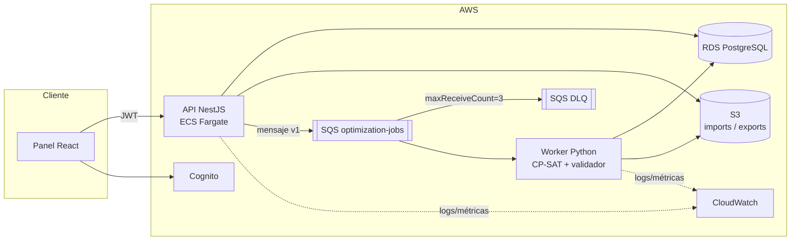
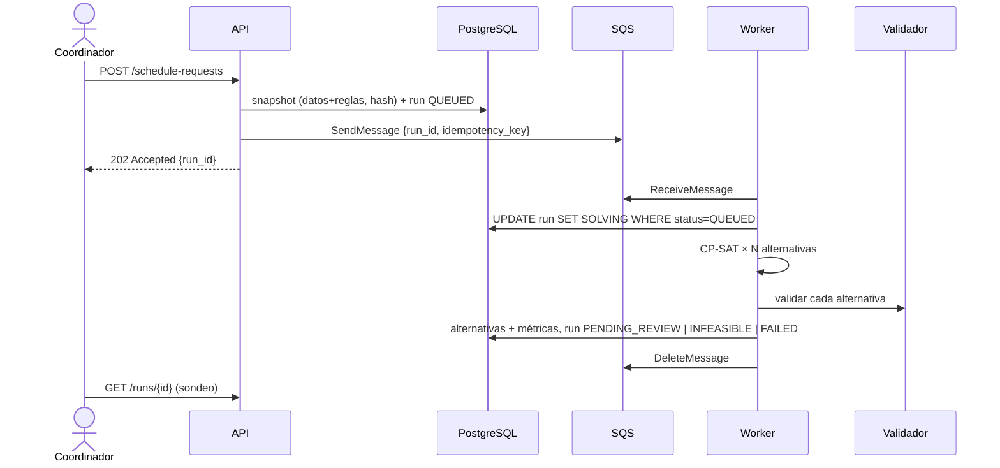
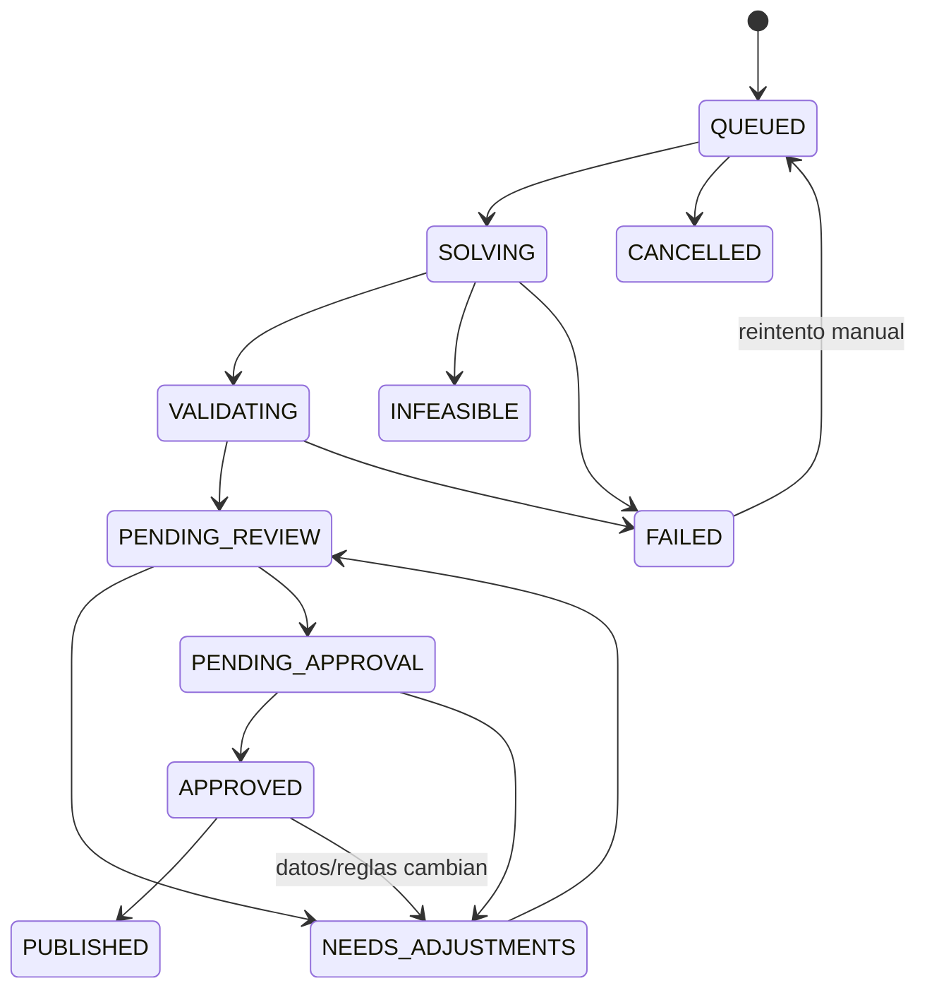

# Arquitectura

Decisiones en `docs/decisions` (ADR-0001…0006). Diagramas fuente en `docs/diagrams/*.mmd`.

## Vista lógica

## Secuencia de una generación

## Estados del trabajo y la propuesta

`TIMEOUT` no es un estado del trabajo sino un `solver_status` de la ejecución: no se encontró
solución dentro del presupuesto, lo que **no** prueba inviabilidad (§4.3 del plan).

## Límites entre componentes

| Límite | Contrato | Versionado |
|---|---|---|
| API ↔ Worker | `data/schemas/job-message.v1.json` | `schema_version` |
| Worker ↔ Solver | `data/schemas/problem.v1.json` → `result.v1.json` | `schema_version` |
| Web ↔ API | OpenAPI generado por NestJS | `/v1` en la ruta |

## Worker de optimización (`services/worker`)

| Situación | Acción | ¿Se borra el mensaje? |
|---|---|---|
| JSON ilegible o fuera de `job-message.v1` | `DISCARDED` (registrado en logs) | Sí |
| Run ya terminado o en curso | `DUPLICATE`, no se resuelve de nuevo | Sí |
| Run en `SOLVING` más antiguo que 2× el límite de tiempo | se reclama (worker anterior caído) | — |
| Hash del snapshot distinto al del mensaje | `FAILED` no reintentable | Sí |
| Error técnico, intento < `maxReceiveCount` | run vuelve a `QUEUED` | No (SQS reintenta) |
| Error técnico en el último intento | `FAILED` | No → termina en la DLQ |
| Resultado obtenido | alternativas + revisión 0 + asignaciones en una transacción | Sí |

Mientras resuelve, el worker extiende la visibilidad del mensaje cada `VISIBILITY_EXTENSION_S/2`
segundos. Ante `SIGTERM` (despliegue o escalado a 0) termina el mensaje en curso y se detiene.

**Hash de revisión:** `sha256` del JSON compacto de la lista ordenada `[[grupo, sesión, franja, aula], …]`.
Lo calculan igual el worker (revisión 0) y la API (revisiones manuales); la aprobación se liga a ese hash.

## Edición manual y revalidación (SCRUM-30)

- Cada ajuste crea una **revisión nueva e inmutable** (`schedule_revisions`, `revision_no` + 1) con sus
  asignaciones completas, el informe del validador y el motivo; nunca se modifica una revisión.
- La API valida con `@us/schedule-validator` (TypeScript). Es una implementación independiente del
  validador Python, verificada con 112 casos dorados generados por el validador Python
  (`tests/fixtures/validator-golden`): mismas violaciones, entidades y penalizaciones.
- Concurrencia optimista: la edición indica `base_revision_id`; si otra persona guardó antes → 409.
- Editar una solicitud en `PENDING_APPROVAL` o `APPROVED` revoca la aprobación vigente y la devuelve a
  `NEEDS_ADJUSTMENTS` (la aprobación está ligada al hash de una revisión concreta).
- Las revisiones con violaciones duras se guardan (para no perder trabajo) pero el trigger
  `check_approval` impide aprobarlas sin excepción autorizada.
