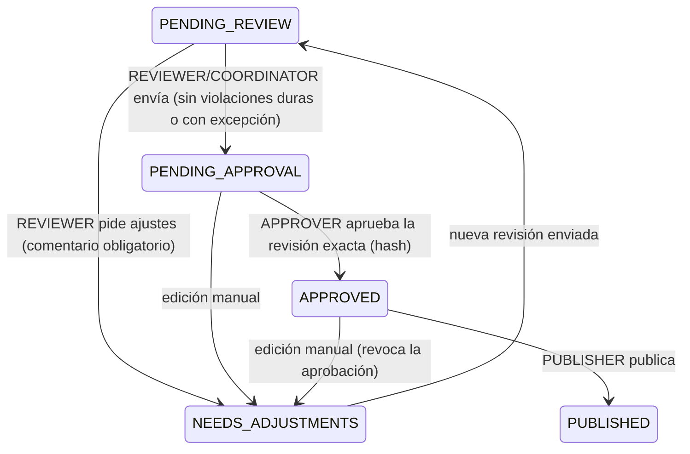

# Gobierno: revisión, aprobación y publicación (SCRUM-31)

| Regla | Dónde se aplica |
|---|---|
| Solo usuarios autenticados (JWT de Cognito firmado, emisor y expiración) | `AuthGuard` (JWKS) |
| Cada acción exige rol (`@Roles`); `ADMIN` puede todo | `AuthGuard` |
| Solo la revisión vigente se revisa/aprueba/publica | `GovernanceService` |
| No se envía a aprobación con violaciones duras sin excepción vigente | API + trigger `check_approval` |
| Excepciones: regla, justificación ≥ 20 caracteres, vencimiento, autorizadas por APPROVER | API + `rule_exceptions` |
| Se aprueba un hash concreto; quien editó la revisión no puede aprobarla | trigger `check_approval` |
| Editar tras enviar/aprobar revoca la aprobación | `RevisionsService` |
| No se publica una aprobación revocada ni algo no aprobado | API + trigger `check_publication` |
| Todo cambio queda en `audit_logs` (append-only) en la misma transacción | `audit()` + trigger |

**Publicación:** genera `horario-publicado.v1` (grupo, asignatura, docente, cohorte, aula, día, hora) y lo
guarda en el bucket de exportaciones (`published/<solicitud>/<publicación>.json`) para el canal institucional.

**Panel web en AWS:** compilar con `VITE_COGNITO_DOMAIN` y `VITE_COGNITO_CLIENT_ID` (salidas `cognito.domain`
y `cognito.web_client_id` de Terraform). Sin esas variables el panel usa la identidad de desarrollo.
