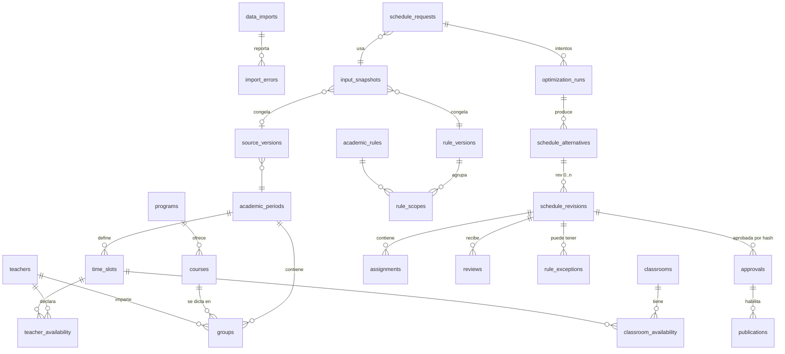

# Modelo de datos (PostgreSQL)

Migraciones: `apps/api/db/migrations` · Runner: `apps/api/db/migrate.sh` · Pruebas: `tests/integration/test_db_schema.py`.

## Garantías implementadas en la base

| Garantía | Mecanismo |
|---|---|
| Snapshots, revisiones, asignaciones y auditoría no se modifican | trigger `forbid_mutation()` |
| Una versión de reglas publicada no cambia | trigger `forbid_published_rule_change()` |
| La aprobación referencia el hash exacto de la revisión | `check_approval()` compara `content_sha256` |
| Quien edita no aprueba | `check_approval()` compara `created_by` / `approved_by` |
| Violaciones duras bloquean la aprobación salvo excepción vigente | `check_approval()` + `rule_exceptions` |
| Solo una aprobación activa por revisión | índice único parcial `WHERE revoked_at IS NULL` |
| No se publica una aprobación revocada | `check_publication()` |
| Un mensaje duplicado no crea otra ejecución | `optimization_runs.idempotency_key UNIQUE` |
