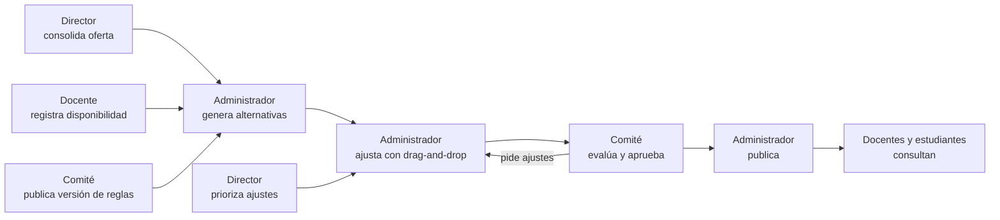

# Actores, responsabilidades y permisos

Estado: aceptado (ADR-0008, SCRUM-43). Reemplaza la matriz de roles técnicos del MVP.

## Actores

| Actor (`app_role`) | Responsabilidades | Alcance |
|---|---|---|
| `ADMINISTRADOR` | Datos maestros · usuarios · periodos; genera alternativas, las **ajusta (drag-and-drop)** y publica | Toda la institución |
| `COMITE_TACTICO` | Configurar reglas · evaluar · aprobar (y autorizar excepciones a reglas duras) | Toda la institución |
| `DIRECTOR` | Consolidar la oferta de su programa · registrar y priorizar ajustes | Su programa |
| `DOCENTE` | Registrar su disponibilidad · consultar su horario publicado | Su registro de docente |
| `ESTUDIANTE` | Consultar el horario publicado | Su programa (y cohorte por defecto) |

Una persona puede tener varios actores. **Quien edita una revisión no puede aprobarla** (trigger
`check_approval`), aunque además sea del comité.

## Flujo

## Permisos por endpoint

| Acción | Endpoint | Actores |
|---|---|---|
| Identidad propia | `GET /me` | Cualquier usuario autenticado |
| Directorio de usuarios | `GET /users`, `PUT /users/:correo`, `GET /teachers` | ADMINISTRADOR |
| Períodos, programas, cargas CSV | `POST /academic-periods`, `POST /programs`, `/imports/*` | ADMINISTRADOR |
| Estado de la oferta | `GET /offers?period=` | ADMINISTRADOR, COMITE_TACTICO, DIRECTOR (solo su programa) |
| Consolidar / reabrir oferta | `POST /offers/consolidate`, `POST /offers/reopen` | DIRECTOR |
| Generar / cancelar | `POST /schedule-requests`, `POST /schedule-requests/:id/cancel` | ADMINISTRADOR |
| Ver solicitudes y alternativas | `GET /schedule-requests*`, `GET /alternatives/*` | ADMINISTRADOR, COMITE_TACTICO, DIRECTOR (su programa o institucionales) |
| Ajuste manual (drag-and-drop) | `POST /alternatives/:id/preview`, `POST /alternatives/:id/revisions` | ADMINISTRADOR |
| Registrar y priorizar ajustes | `POST /adjustments`, `PATCH /adjustments/:id/priority` | DIRECTOR |
| Resolver o rechazar ajustes | `POST /adjustments/:id/resolve` | ADMINISTRADOR |
| Evaluar, excepciones, aprobar | `POST /revisions/:id/reviews`, `/exceptions`, `/approvals` | COMITE_TACTICO |
| Publicar | `POST /approvals/:id/publish` | ADMINISTRADOR |
| Versiones de reglas | `GET /rule-versions*` (ADMINISTRADOR, COMITE_TACTICO); `POST`, `PUT`, `publish` | COMITE_TACTICO |
| Auditoría | `GET /audit` | ADMINISTRADOR, COMITE_TACTICO |
| Disponibilidad propia | `GET/PUT /me/availability?period=` | DOCENTE (cerrada si el período ya tiene horario publicado) |
| Horario propio | `GET /me/schedule?period=` | DOCENTE |
| Horario publicado | `GET /published-schedules?period=&program=&cohort=` | Cualquier usuario autenticado (ESTUDIANTE limitado a su programa) |

## Identidad y directorio

- La cuenta de acceso es de Cognito (correo institucional). Los grupos de Cognito tienen los mismos
  nombres que los actores (`terraform/modules/auth`).
- El ADMINISTRADOR completa el directorio (`app_users`): actor y alcance. Roles efectivos = grupos de
  Cognito ∪ roles del directorio. Desactivar a alguien en el directorio le quita el acceso.
- Restricciones en la base: un DIRECTOR o ESTUDIANTE necesita programa; un DOCENTE necesita docente
  vinculado (único); un administrador no puede quitarse su propio acceso.

## Matriz RACI por actividad

| Actividad | Administrador | Comité táctico | Director | Docente | Estudiante |
|---|---|---|---|---|---|
| Cargar datos y usuarios | R/A | | C | | |
| Registrar disponibilidad | C | | | R/A | |
| Consolidar oferta | C | | R/A | | |
| Definir reglas | C | R/A | C | | |
| Generar alternativas | R/A | | | | |
| Priorizar ajustes | C | C | R/A | | |
| Ajustes manuales | R/A | C | C | | |
| Evaluar y aprobar | C | R/A | C | | |
| Publicar | R/A | C | | | |
| Consultar horario | | | | R | R |

R = responsable, A = rinde cuentas, C = consultado.
