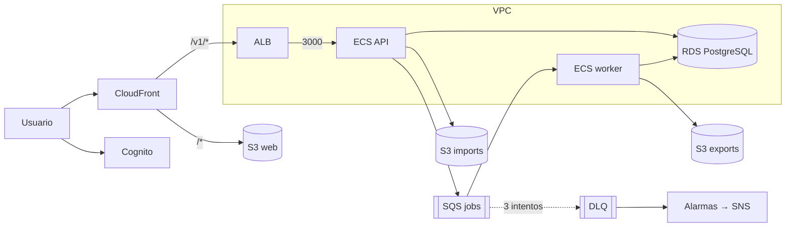

# Infraestructura (Terraform)

Toda la infraestructura AWS del proyecto vive aquí (ADR-0007). Compatible con Terraform ≥ 1.6 y OpenTofu.

```
terraform/
├── bootstrap/              # bucket S3 de estado + tabla DynamoDB de bloqueo (estado local, una sola vez)
├── modules/
│   ├── network/            # VPC 2 AZ, subredes públicas/privadas, NAT, endpoint S3, flow logs
│   ├── database/           # RDS PostgreSQL 16 cifrado, TLS obligatorio, secreto gestionado por RDS
│   ├── storage/            # buckets imports (retención 1 año) y exports, cifrados y privados
│   ├── queue/              # SQS optimization-jobs + DLQ (maxReceiveCount 3)
│   ├── registry/           # ECR api y worker (inmutables, escaneo al subir)
│   ├── auth/               # Cognito: grupos por rol, cliente SPA con PKCE, sin autoregistro
│   ├── compute/            # ECS Fargate ARM64: API detrás de ALB, worker autoescalado por cola
│   ├── web/                # S3 + CloudFront (OAC); /v1/* se enruta a la API
│   ├── observability/      # alarmas → SNS, presupuesto mensual, dashboard
│   └── platform/           # composición de todos los módulos
└── environments/
    ├── dev/                # mínimo coste, destruible
    └── pilot/              # piloto con Administración, protección de borrado
```

## Arquitectura desplegada



## Despliegue automatizado de dev

```bash
AWS_PROFILE=<perfil> EXPECTED_ACCOUNT_SUFFIX=<últimos dígitos> ALERT_EMAIL=<correo> ./scripts/deploy-dev.sh
```

Requiere AWS CLI v2, Terraform ≥ 1.6, Node.js ≥ 20 y sesión válida en el perfil (no hace falta Docker: las imágenes ARM64 se construyen en un CodeBuild temporal). El script verifica
que la cuenta sea la esperada, crea el estado remoto, publica las imágenes ARM64, muestra el `plan` y
**pide confirmación** antes de aplicar, ejecuta las migraciones, publica el panel y hace una prueba de humo.
Es idempotente: si un paso falla se puede relanzar.

## Primer despliegue (manual)

```bash
# 1. Estado remoto (una vez por cuenta)
cd terraform/bootstrap
terraform init && terraform apply
# anota state_bucket y lock_table

# 2. Entorno
cd ../environments/dev
cp backend.hcl.example backend.hcl            # completa bucket con el ACCOUNT_ID
cp terraform.tfvars.example terraform.tfvars  # image_tag y correos de alerta
terraform init -backend-config=backend.hcl
terraform plan -out=tfplan
terraform apply tfplan

# 3. Imágenes y migraciones
aws ecr get-login-password | docker login --username AWS --password-stdin <registry>
docker buildx build --platform linux/arm64 -t <repo-api>:<sha> apps/api --push
docker buildx build --platform linux/arm64 -t <repo-worker>:<sha> services --push
aws ecs run-task --cluster <cluster> --task-definition <api_task_definition> \
  --overrides '{"containerOverrides":[{"name":"api","command":["npm","run","migrate"]}]}' ...
```

Commitea `.terraform.lock.hcl` de cada raíz tras el primer `terraform init`.

## Reglas de operación

- `apply` siempre manual y revisando el `plan`; CI solo hace `fmt`, `validate`, `tflint` y `plan` (OIDC).
- Nada de secretos en variables o en el estado: la contraseña de RDS la gestiona Secrets Manager.
- Cambios de infraestructura en ramas `feature/SCRUM-N-*` como el resto del código.
- `pilot` tiene `deletion_protection`; para destruirlo hay que desactivarla explícitamente en un PR.

## Costes de referencia (dev, us-east-1, aprox.)

| Recurso | USD/mes |
|---|---|
| NAT Gateway (1) | ~33 |
| RDS db.t4g.micro + 20 GB | ~15 |
| ALB | ~17 |
| Fargate API 0,25 vCPU 24/7 (ARM) | ~7 |
| Worker 2 vCPU, solo con trabajos | según uso |
| CloudFront, S3, SQS, Cognito | < 5 |

El presupuesto de `dev` (USD 50) alerta al 80 % real y al 100 % pronosticado; el NAT es el mayor
coste fijo, así que en `dev` puede apagarse el entorno fuera de horario.

## Validación local sin credenciales

```bash
terraform fmt -check -recursive
for d in bootstrap environments/dev environments/pilot; do terraform -chdir=$d init -backend=false && terraform -chdir=$d validate; done
tflint --init && tflint --recursive --config "$PWD/.tflint.hcl"
```
